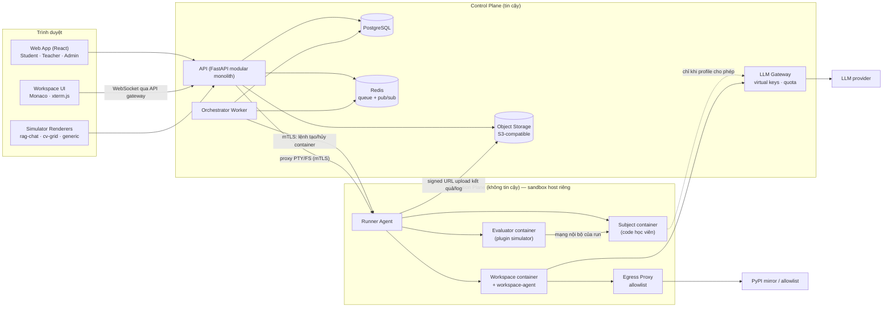
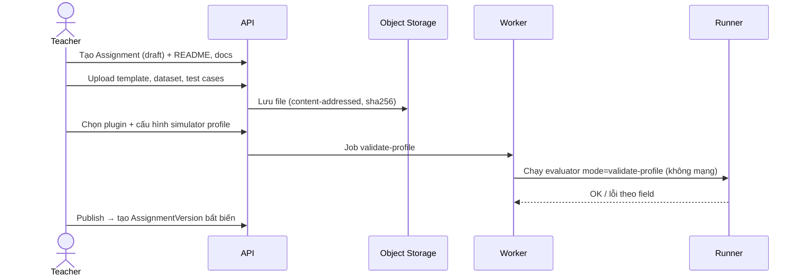
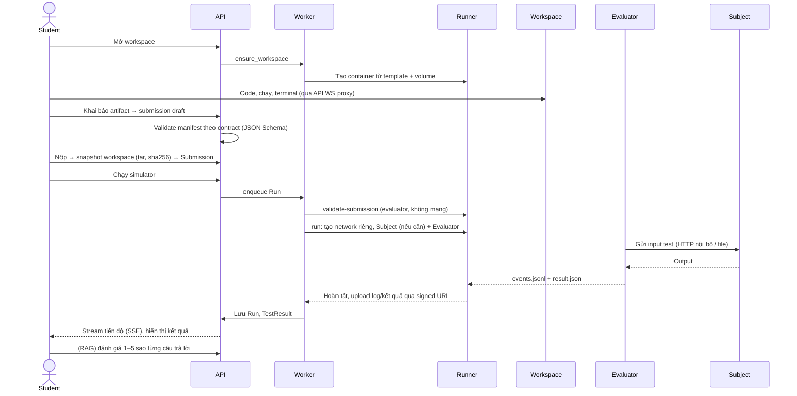

# 04 — Kiến trúc tổng thể

## 1. Nguyên tắc kiến trúc

1. **Một lõi, nhiều loại bài tập.** Lõi quản lý *vòng đời* (khóa học, bài tập, workspace, submission, run, đánh giá). Logic *đặc thù* bài toán nằm trong plugin và assignment package.
2. **Ranh giới tin cậy rõ ràng.** Control plane (API, DB) không bao giờ thực thi code học viên hay code plugin. Execution plane (runner + sandbox) không có quyền đọc DB.
3. **Bất biến hóa những gì cần tái lập.** AssignmentVersion, Submission, phiên bản plugin và TestSet version là bất biến; mọi Run tham chiếu chính xác các phiên bản đó.
4. **Modular monolith trước, tách dịch vụ khi có lý do.** Chỉ có 3 tiến trình triển khai riêng trong POC: `api`, `worker` (orchestrator), `runner-agent` (trên sandbox host). Lý do tách runner là bảo mật, không phải scale.
5. **Contract-first.** JSON Schema trong `sdk/contracts/` là nguồn sự thật; sinh model Pydantic và type TypeScript từ đó.

## 2. Sơ đồ thành phần **[ĐỀ XUẤT]**

### Trách nhiệm từng thành phần

| Thành phần | Trách nhiệm | Không được làm |
|---|---|---|
| Web App | UI 3 vai trò, render simulator theo `result_view` | Chứa logic chấm; giữ secret |
| API | Auth, RBAC, CRUD nghiệp vụ, import Excel, signed URL, proxy WebSocket tới workspace | Chạy code học viên/plugin; mở Docker socket |
| Orchestrator Worker | Nhận job từ queue, dựng RunSpec, gọi runner, cập nhật trạng thái, xử lý timeout/retry/cancel | Đọc file test vào bộ nhớ để chấm |
| Runner Agent | Tạo/hủy container theo spec đã ký, áp quota, mạng, mount; stream log; cleanup | Truy cập DB; tự quyết định nghiệp vụ |
| Workspace container | Môi trường code tương tác của 1 học viên/1 bài | Thấy test set ẩn; có secret nền tảng |
| Subject container | Chạy sản phẩm học viên (entrypoint/app) từ snapshot submission, read-only | Có internet (mặc định); thấy nhãn chuẩn |
| Evaluator container | Code plugin: gửi input, nhận output, so sánh, xuất kết quả | Ghi vào DB; gọi ra ngoài trừ khi manifest khai báo |
| LLM Gateway | Cấp virtual key theo học viên/run, hạn mức token/chi phí, log usage | Lộ key provider thật |
| Egress Proxy | Allowlist domain cho workspace (PyPI mirror, LLM gateway) | Cho truy cập metadata cloud / mạng nội bộ |

## 3. Luồng dữ liệu chính

### 3.1 Giảng viên thiết kế bài tập

### 3.2 Học viên làm bài và chạy simulator

## 4. Vai trò, quyền và ranh giới trách nhiệm

### 4.1 Ma trận quyền (POC) **[ĐỀ XUẤT]**

Quyền gắn theo **phạm vi**: `org` (toàn tổ chức) hoặc `course` (qua `CourseMembership`).

| Quyền | Admin | Teacher (course) | Student (course) | Runtime (service) |
|---|---|---|---|---|
| Quản lý user, vai trò, tổ chức | ✓ | — | — | — |
| Đăng ký/bật/tắt plugin, runtime profile | ✓ | — (chỉ chọn plugin đã bật) | — | — |
| Tạo/sửa course, import Excel, xuất bản | ✓ | ✓ | — | — |
| Tạo/sửa assignment, dataset, test case, rubric, profile | ✓ | ✓ | — | — |
| Xem test case ẩn / nhãn chuẩn | ✓ | ✓ | Theo `visibility` của trường | Chỉ evaluator của run tương ứng |
| Mở workspace, nộp bài, chạy simulator | (impersonate có audit) | ✓ (chế độ thử bài) | ✓ (bài của mình) | — |
| Xem submission/run của học viên khác | ✓ | ✓ (trong course) | — | — |
| Đánh giá sao | — | ✓ (đánh giá giảng viên) | ✓ (tự đánh giá run của mình) | — |
| Ghi TestResult | — | — | — | ✓ (qua token run có hạn) |
| Xem audit log | ✓ | Phần liên quan course | — | — |

### 4.2 Ranh giới trách nhiệm
- **Admin** chịu trách nhiệm *nền tảng*: ai được vào, plugin nào an toàn để bật, giới hạn tài nguyên mặc định.
- **Teacher** chịu trách nhiệm *nội dung*: đề bài đúng, dữ liệu hợp lệ và được phép sử dụng, test case có nhãn đúng, profile cấu hình hợp lệ. Teacher **không** viết code plugin trong POC; plugin do team kỹ thuật phát triển và Admin bật.
- **Student** chịu trách nhiệm *sản phẩm*: tuân theo contract, khai báo artifact đúng.
- **Runtime/Simulator** chịu trách nhiệm *thực thi trung thực*: chạy đúng phiên bản, ghi đủ log, không vượt quyền. Kết quả kỹ thuật của simulator **không phải điểm số**; điểm (nếu có) là quyết định của Teacher (xem `Evaluation` vs `Grade` ở [08](08-data-model.md)).
