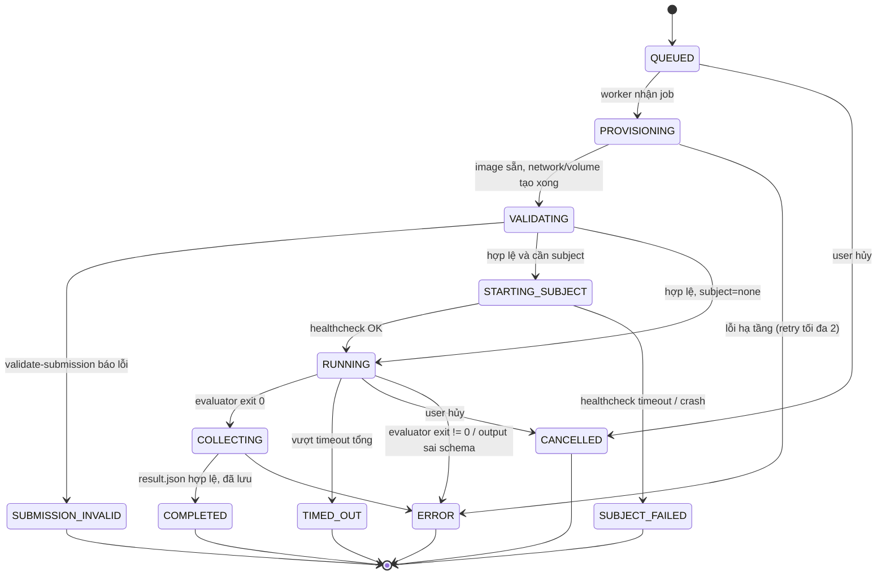
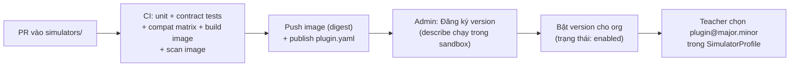

# 06 — Kiến trúc Simulator Plugin

> Toàn bộ interface, schema và ví dụ trong tài liệu này là **[ĐỀ XUẤT]** cho contract `simulator.v1`. Tên trường có thể đổi trong Phase 3; **nguyên tắc** ở §1 là phần cần chốt.

## 1. Nguyên tắc (cần chốt)

1. **Plugin = container image + manifest.** Lõi không bao giờ `import` code plugin. Plugin viết bằng ngôn ngữ bất kỳ; SDK Python là tiện ích, không phải ràng buộc.
2. **Giao tiếp qua file và JSON-lines**, có version. Không có RPC hai chiều giữa lõi và plugin trong `v1` → dễ kiểm thử, dễ tái lập, không cần mở cổng vào evaluator.
3. **Nền tảng sở hữu vòng đời container**; plugin chỉ *khai báo* nhu cầu (subject, mạng, tài nguyên). Plugin không có Docker socket, không tự tạo container.
4. **Kết quả theo phong bì chuẩn + phần dữ liệu đặc thù** có schema riêng của plugin.
5. **Mọi Run được pin**: plugin `id@version` + image digest + AssignmentVersion + TestSet version + Submission → tái lập được.
6. **Plugin không ghi DB, không giữ trạng thái giữa các run.** Mọi trạng thái nằm trong output của run.

## 2. Khái niệm

| Khái niệm | Là gì | Ai sở hữu |
|---|---|---|
| `SimulatorPlugin` | Một loại simulator (vd `cole.cv-ok-ng`), nhiều phiên bản | Team kỹ thuật; Admin bật/tắt |
| `SimulatorPluginVersion` | Một bản phát hành: manifest + image digest + schemas | CI phát hành, bất biến |
| `SimulatorProfile` | Cấu hình của plugin cho **một** AssignmentVersion (ngưỡng, timeout, tiêu chí…) — validate theo `profile.schema.json` của plugin | Teacher |
| `TestSet` / `TestCase` | Dữ liệu kiểm thử, có version | Teacher |
| `Run` | Một lần thực thi plugin trên một Submission | Hệ thống |
| `Subject` | Sản phẩm học viên đang chạy (container) mà evaluator tương tác | Nền tảng khởi chạy theo contract |

## 3. Cấu trúc gói plugin

```
simulators/cv-ok-ng/
├── plugin.yaml                 # manifest — nguồn sự thật về khả năng của plugin
├── Dockerfile                  # image evaluator
├── src/cv_ok_ng/               # logic đánh giá
├── schemas/
│   ├── profile.schema.json     # cấu hình giảng viên được phép đặt
│   ├── testcase.schema.json    # cấu trúc một test case
│   ├── result-data.schema.json # phần "data" đặc thù trong kết quả
│   └── submission-contract.schema.json  # các artifact plugin hỗ trợ
├── ui/                         # (tùy chọn) renderer FE — xem §9
├── fixtures/                   # submission mẫu đúng/sai, testset nhỏ
├── tests/                      # unit + contract tests (dùng sdk testkit)
├── CHANGELOG.md
└── README.md
```

### `plugin.yaml` **[MINH HỌA]**
```yaml
apiVersion: cole.dev/simulator.v1
id: cole.cv-ok-ng
version: 1.2.0
displayName: "Computer Vision — Kiểm tra OK/NG"
tracks: [AI_ENGINEER]
image: registry.internal/simulators/cv-ok-ng@sha256:…     # điền bởi CI khi phát hành
sdk: { name: cole-sim-sdk, range: ">=1.0,<2.0" }
modes: [describe, validate-profile, validate-submission, run]

schemas:
  profile: schemas/profile.schema.json
  testcase: schemas/testcase.schema.json
  resultData: schemas/result-data.schema.json
  submissionContract: schemas/submission-contract.schema.json

subject:                         # nền tảng sẽ khởi chạy subject theo artifact học viên khai báo
  supportedKinds: [none, python_entrypoint, http_service]
  # none: evaluator tự nạp artifact dạng dữ liệu (vd ONNX) — không chạy code học viên

resources:
  evaluator: { cpu: "1", memory: "2Gi", timeoutSeconds: 900 }
  subjectDefault: { cpu: "1", memory: "2Gi" }
network:
  evaluatorEgress: none          # none | llm_gateway | allowlist
  subjectEgress: none

results:
  view: cv-grid@1                # renderer FE ưu tiên; fallback generic-table@1
  metrics:                       # khai báo trước để UI/so sánh lịch sử
    - { key: precision, label: "Precision", unit: ratio, higherIsBetter: true }
    - { key: recall,    label: "Recall",    unit: ratio, higherIsBetter: true }
    - { key: f1,        label: "F1",        unit: ratio, higherIsBetter: true }
    - { key: latency_p95_ms, label: "Latency p95", unit: ms, higherIsBetter: false }
```

## 4. Mô hình thực thi

Mỗi *mode* là một lần chạy container evaluator riêng với lệnh `sim <mode>`.

| Mode | Khi nào | Input | Output | Mạng | Subject |
|---|---|---|---|---|---|
| `describe` | Lúc đăng ký phiên bản (CI + Admin) | — | capabilities JSON | none | — |
| `validate-profile` | Teacher lưu profile / trước publish | profile, testset metadata | `validation.json` | none | — |
| `validate-submission` | Học viên nộp; trước mỗi run | manifest + artifact (read-only) | `validation.json` (lỗi theo artifact) | none | — |
| `run` | Học viên/Teacher bấm chạy | RunSpec, profile, testset, artifact | `events.jsonl`, `result.json`, file phụ | theo manifest | theo manifest + manifest học viên |

### Bố cục mount trong evaluator
```
/sim/input/run-spec.json        (ro)  RunSpec — xem §6
/sim/input/profile.json         (ro)  SimulatorProfile đã validate
/sim/input/testset/             (ro)  test case + file + nhãn chuẩn (CHỈ evaluator thấy)
/sim/input/submission/          (ro)  artifact theo manifest (đã giải nén từ snapshot)
/sim/output/                    (rw, quota)  events.jsonl, result.json, attachments/
/tmp                            (tmpfs, quota)
```
Subject container (nếu có) chỉ được mount `/app` = snapshot submission (ro) + `/tmp`. **Không** mount testset. Evaluator gọi subject qua `run-spec.subject.baseUrl` trên network riêng của run (không route ra ngoài).

## 5. Vòng đời một Run



Sau mọi trạng thái kết thúc: **CLEANUP** (luôn chạy, idempotent) — dừng container, xóa network/volume tạm, thu hồi token run, upload log còn lại. Trạng thái cleanup ghi riêng (`cleanup_status`) để không che kết quả.

### Phân biệt kết quả
| Trạng thái | Nghĩa | Lỗi của ai | Hiển thị cho học viên |
|---|---|---|---|
| `COMPLETED` | Run chạy xong; từng test có thể pass/fail | — | Kết quả từng test |
| `SUBMISSION_INVALID` | Sản phẩm không đúng contract | Học viên | Danh sách lỗi + hướng dẫn sửa |
| `SUBJECT_FAILED` | Ứng dụng học viên không khởi động/healthcheck | Học viên | Log khởi động của subject |
| `TIMED_OUT` | Vượt thời gian | Thường là học viên | Test đã xong + test bị bỏ |
| `ERROR` | Lỗi nền tảng/plugin | Nền tảng | Thông báo chung + mã sự cố; chi tiết cho Admin |
| `CANCELLED` | Bị hủy | — | — |

### Timeout, retry, cancel
- **Timeout 3 tầng:** mỗi test case (`profile.perCaseTimeoutSeconds`, plugin tự áp), subject startup (`healthcheck.timeoutSeconds`), tổng run (`min(profile, manifest, quota org)`, runner áp bằng kill cứng).
- **Retry:** chỉ worker retry **PROVISIONING** (lỗi hạ tầng, tối đa 2, backoff). Plugin được retry *nội bộ* lời gọi subject cho lỗi kết nối (tối đa N theo profile), **không** retry lỗi 4xx hoặc output sai. Không retry toàn run tự động sau khi đã RUNNING (tránh tốn chi phí LLM gấp đôi).
- **Cancel:** API đặt `cancel_requested_at` → worker gửi lệnh tới runner → SIGTERM evaluator (grace 10s, plugin flush `result.json` dạng partial) → SIGKILL → cleanup.
- **Idempotency:** mỗi Run có `attempt`; runner dùng `run_id+attempt` làm nhãn container để dọn rác nếu worker chết giữa chừng (reaper chạy định kỳ).

## 6. RunSpec (lõi → plugin) **[MINH HỌA]**

```json
{
  "contract": "simulator.v1",
  "runId": "run_01J…",
  "attempt": 1,
  "mode": "run",
  "plugin": { "id": "cole.cv-ok-ng", "version": "1.2.0" },
  "assignment": { "id": "asg_cv_okng", "versionId": "asv_…", "version": 3 },
  "submission": {
    "id": "sub_…",
    "root": "/sim/input/submission",
    "manifest": { "...": "submission.manifest.yaml đã chuẩn hóa thành JSON" }
  },
  "testset": { "id": "ts_…", "version": 2, "root": "/sim/input/testset", "count": 400 },
  "subject": { "kind": "python_entrypoint", "baseUrl": "http://subject:8080", "ready": true },
  "limits": { "totalTimeoutSeconds": 900, "maxOutputBytes": 52428800 },
  "services": { "llmGateway": null },
  "locale": "vi-VN"
}
```

## 7. Events (plugin → lõi, `events.jsonl`) **[MINH HỌA]**

Mỗi dòng một JSON; runner stream lên worker → SSE tới UI.
```json
{"t":"2026-10-21T10:00:01Z","type":"progress","done":120,"total":400}
{"t":"…","type":"log","level":"info","message":"Loaded ONNX model, opset 17"}
{"t":"…","type":"test_result","caseId":"img_0007","status":"failed","summary":"Dự đoán OK, nhãn NG"}
{"t":"…","type":"warning","code":"LATENCY_HIGH","message":"p95 > 500ms"}
```
Giới hạn: tối đa 5 MB events/run; vượt → runner cắt và ghi `truncated=true`.

## 8. Result (phong bì chuẩn) **[MINH HỌA]**

```json
{
  "contract": "simulator.v1",
  "runId": "run_01J…",
  "outcome": "completed",
  "summary": {
    "headline": "352/400 mẫu đúng",
    "metrics": [
      {"key":"precision","value":0.912},
      {"key":"recall","value":0.874},
      {"key":"f1","value":0.893},
      {"key":"latency_p95_ms","value":41.3}
    ]
  },
  "testResults": [
    {
      "caseId": "img_0007",
      "status": "failed",
      "durationMs": 38,
      "measurements": {"latency_ms": 38},
      "data": {"predicted":"OK","expected":"NG","score":0.41,"outcome":"FN"},
      "attachments": []
    }
  ],
  "data": {"confusionMatrix": {"TP":180,"FP":17,"FN":26,"TN":177}, "threshold":0.5, "positiveClass":"NG"},
  "diagnostics": {"environment": {"cpu":"1 vCPU (gVisor)","onnxruntime":"1.x"}}
}
```
- `status` của test: `passed | failed | error | skipped | needs_review`. RAG dùng `needs_review` (chờ đánh giá người).
- `data` (cấp test và cấp run) được validate theo `result-data.schema.json` của plugin; lõi lưu vào JSONB, không diễn giải.
- `summary.metrics` chỉ chứa key đã khai báo trong `plugin.yaml` → UI so sánh lịch sử được mà không cần biết plugin.

## 9. Tách UI khỏi logic

- Backend plugin **không** sinh HTML. Nó trả dữ liệu + `results.view`.
- Frontend có **renderer registry**: `{"cv-grid@1": CvGridView, "rag-chat@1": RagChatView, "generic-table@1": GenericTableView}`.
- Plugin mới không có renderer riêng vẫn hiển thị được bằng `generic-table@1` (bảng test + metrics + JSON đã định dạng) → **thêm plugin không bắt buộc sửa frontend**.
- Renderer riêng nằm trong `simulators/<id>/ui/` và được frontend build gom vào qua alias, **không** nằm trong code lõi `apps/web/src/core`. Renderer chỉ nhận props theo type sinh từ `result-data.schema.json`.
- Mở rộng sau POC: renderer dạng iframe sandbox + `postMessage` API để nạp động không cần build lại.
- Tương tác sau run (đánh giá sao, ghi chú) là **chức năng lõi** (`Evaluation`), renderer chỉ gọi component lõi `<RatingControl>`; plugin không lưu đánh giá.

## 10. SDK Python **[MINH HỌA]**

```python
# sdk/python/cole_sim_sdk/plugin.py
class SimulatorPlugin(Protocol):
    def describe(self) -> Capabilities: ...
    def validate_profile(self, ctx: ProfileContext) -> ValidationReport: ...
    def validate_submission(self, ctx: SubmissionContext) -> ValidationReport: ...
    def run(self, ctx: RunContext) -> RunResult: ...

class RunContext:
    spec: RunSpec                 # đã parse + validate
    profile: dict                 # đã validate theo profile.schema.json
    testset: TestSetReader        # iter_cases(), open_file(case, name)
    submission: SubmissionReader  # artifact("model"), path("inference.entrypoint")
    subject: SubjectClient | None # http client có timeout/retry theo profile
    events: EventWriter           # progress(), log(), test_result()
    cancelled: Callable[[], bool] # kiểm tra SIGTERM

def main(plugin: SimulatorPlugin) -> None:
    """Entrypoint `sim <mode>`: đọc /sim/input, gọi hàm tương ứng, ghi /sim/output, mã thoát chuẩn."""
```

**Testkit** (`sdk/testkit`): `run_plugin_locally(plugin_dir, fixture)` chạy image với đúng mount như production (Docker thường, không gVisor), kiểm tra output theo schema; bộ **contract tests** dùng chung mọi plugin (describe hợp lệ, xử lý cancel, partial result khi SIGTERM, không ghi ngoài `/sim/output`, không cần mạng khi khai báo `none`).

## 11. Đăng ký, version, bật/tắt, triển khai



- **SemVer cho plugin:** major = đổi schema profile/testcase/result không tương thích; minor = thêm trường tùy chọn/metric; patch = sửa lỗi.
- **Pin:** `SimulatorProfile` lưu `pluginId` + `versionRange` (vd `~1.2`) khi soạn; **khi publish AssignmentVersion, phân giải thành version cụ thể + digest** và cố định. Nâng cấp plugin cho bài đã xuất bản = Teacher tạo AssignmentVersion mới (có bước `validate-profile` lại).
- **Trạng thái version:** `registered → enabled → deprecated → disabled`. `disabled` chặn run mới; run cũ vẫn xem được.
- **Contract version** (`simulator.v1`) độc lập với version plugin. Lõi hỗ trợ đồng thời `v1` và `v2` trong giai đoạn chuyển tiếp.

## 12. Thêm simulator mới không gây regression

1. Tạo từ `simulators/_template/` (scaffold có sẵn plugin.yaml, Dockerfile, schemas rỗng, tests).
2. Chỉ thêm file trong `simulators/<id>/` (+ tùy chọn `ui/`). **CODEOWNERS** chặn PR plugin sửa `backend/` hoặc `sdk/contracts/` trừ khi có review của platform team.
3. CI chạy contract tests cho **mọi** plugin khi `sdk/` hoặc `runtime/` đổi; chỉ chạy test của plugin bị đổi khi PR chỉ đụng `simulators/<id>/`.
4. Image bất biến theo digest → phát hành bản mới không ảnh hưởng assignment đang pin bản cũ.
5. Golden tests: mỗi plugin có fixture submission + `expected-result.json`; so sánh sau mỗi thay đổi (bỏ qua trường thời gian).

## 13. Ma trận tương thích

| Trục | Kiểm tra |
|---|---|
| Lõi ↔ contract | Lõi parse được mọi `result.json` mẫu của mọi plugin enabled (fixture trong repo) |
| SDK ↔ plugin | Plugin build với SDK min và max trong `sdk.range` |
| Contract v1 ↔ v2 | Lõi mới vẫn chạy plugin v1 (giai đoạn chuyển tiếp) |
| Plugin ↔ assignment | Khi nâng plugin, chạy `validate-profile` trên mọi profile đang dùng version cũ (job báo cáo cho Admin) |
| Renderer ↔ result-data | Type TS sinh từ schema; build FE fail nếu renderer lệch schema |

## 14. Plugin mẫu chứng minh mở rộng: `cole.echo-sample` **[MINH HỌA]**

Mục đích duy nhất: chứng minh tiêu chí "thêm simulator không sửa lõi".
- Subject: `python_entrypoint` với hàm `transform(text) -> text`.
- Test case: `{input, expected}`; so sánh chuẩn hóa khoảng trắng.
- Không có renderer riêng → dùng `generic-table@1`.
- Nghiệm thu: PR thêm plugin chỉ đụng `simulators/echo-sample/**` và `content/assignments/ai-echo-sample/**`.

## 15. Điểm mở rộng sau POC

| Nhu cầu | Hướng mở rộng contract |
|---|---|
| Simulator tương tác thời gian thực (vd roleplay BA, chat tự do với RAG) | Mode `session`: evaluator mở HTTP, lõi proxy qua WebSocket có auth, giới hạn thời lượng |
| Chấm tự động bằng LLM | `services.llmGateway` cho evaluator + `Evaluation.evaluator_type = auto` |
| DE pipeline | Subject kind `sql_service`/`spark_job`; runtime profile mới; plugin `cole.de-etl-check` |
| GPU | `resources.evaluator.gpu`, runner chọn node pool GPU |
