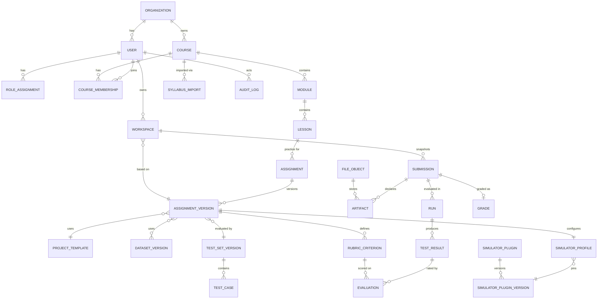

# 08 — Mô hình dữ liệu, contract và manifest

## 1. Sơ đồ quan hệ **[ĐỀ XUẤT]**



## 2. Danh sách entity

Ký hiệu: **P** = cần cho POC · **E** = nền tảng mở rộng (có bảng/trường nhưng tối thiểu) · **L** = sau POC.

| Entity | Mức | Trường chính | Version? | Ghi chú |
|---|---|---|---|---|
| Organization | P | id, name, settings(jsonb: quota mặc định) | — | 1 bản ghi trong POC |
| User | P | id, org_id, email, name, password_hash, status | — | |
| Role / RoleAssignment | P | role ∈ {admin, teacher, student}, scope (org) | — | Quyền chi tiết là hằng số trong code (`permissions.py`), không bảng Permission riêng ở POC |
| CourseMembership | P | user_id, course_id, role_in_course | — | Phạm vi course cho teacher/student |
| Course | P | id, org_id, track (AI_ENGINEER/DATA_ENGINEER/BUSINESS_ANALYST), title, status (draft/published), execution_status (active/planned) | E | `execution_status=planned` cho DE/BA |
| Module | P | course_id, order, code, title, objectives(md), group_path (vd "Học phần 1") | — | `group_path` chứa cấp Học phần/Phần mà không cần thêm bảng |
| Lesson | P | module_id, order, session_numbers int[], title, content(md), practice(md), practice_candidate bool | — | |
| SyllabusImport | P | course_id, source_file_id, mapping_profile(jsonb), rows(jsonb), warnings(jsonb), status | — | Bản nháp import, có thể sửa từng hàng |
| Assignment | P | id, course_id, lesson_id?, slug, title, assignment_type (vd `ai.cv-classification`), current_version_id | — | |
| **AssignmentVersion** | P | assignment_id, version int, status (draft/published/archived), readme(md), docs_bundle_file_id, template_id, contract(jsonb), profile_id, testset_version_id, published_at | **Bất biến khi published** | Mọi submission tham chiếu version |
| ProjectTemplate | P | id, file_id (tar), sha256, run_command, default_manifest(jsonb) | Bất biến (content-addressed) | |
| Dataset / DatasetVersion | P | dataset: name, visibility; version: file_id/manifest, sha256, row/file count, license_note | **Có** | Dataset cấp cho học viên (công khai trong workspace) |
| TestSet / TestSetVersion | P | testset: name; version: index_file_id, count, sha256 | **Có** | Tách khỏi Dataset: test set ẩn mặc định |
| TestCase | P | testset_version_id, case_key, input(jsonb), expected(jsonb), notes(jsonb), field_visibility(jsonb), tags | Theo TestSetVersion | `expected` không bao giờ trả cho student nếu visibility=hidden |
| RubricCriterion | P | assignment_version_id, key, label, scale_min, scale_max, description, applies_to (test/run) | Theo AV | RAG mặc định: `overall` 1–5 |
| SimulatorPlugin | P | id (`cole.cv-ok-ng`), display_name, tracks[], owner | — | |
| SimulatorPluginVersion | P | plugin_id, semver, image_digest, manifest(jsonb), schemas(jsonb), status (registered/enabled/deprecated/disabled), contract_version | **Bất biến** | |
| SimulatorProfile | P | plugin_version_id (đã phân giải khi publish), version_range, config(jsonb), validated_at, validation_report | Theo AV | |
| RuntimeProfile | E | key (python-cpu, vscode, sql-sandbox), image_digest, status (active/planned), default_limits | Có | DE/BA = planned |
| Workspace | P | user_id, assignment_version_id, runtime_profile, volume_ref, status, last_active_at | — | |
| **Submission** | P | workspace_id, assignment_version_id, seq, snapshot_file_id, sha256, manifest(jsonb), validation_status, validation_report, submitted_at | **Bất biến** | `seq` = lịch sử phiên bản bài nộp |
| Artifact | P | submission_id, key (vd `model`), kind, path, format, sha256, size, metadata(jsonb) | Theo Submission | Chuẩn hóa từ manifest để truy vấn |
| **Run** | P | submission_id, plugin_version_id, image_digest, testset_version_id, status, attempt, requested_by, timings, limits, summary(jsonb), result_file_id, log_file_id, cost(jsonb), cancel_requested_at, cleanup_status | Bất biến sau kết thúc | |
| TestResult | P | run_id, case_key, status, duration_ms, measurements(jsonb), data(jsonb), attachments(jsonb) | Theo Run | `data` theo schema plugin |
| **Evaluation** | P | test_result_id? / run_id?, criterion_key, score, comment, evaluator_type (student_self/teacher/auto), evaluator_id, created_at, superseded_by | Append-only | Đánh giá sao RAG |
| Grade | E | submission_id, score, feedback, graded_by | — | Tách khỏi kết quả kỹ thuật (Q-06) |
| FileObject | P | id, storage_key, bucket_class (public/private/answer_key), sha256, size, mime, created_by, scan_status | — | Bucket `answer_key` chỉ worker đọc |
| LlmUsage | P | run_id?/workspace_id?, user_id, model, prompt_tokens, completion_tokens, cost_estimate | — | Đồng bộ từ gateway |
| AuditLog | P | actor_id, actor_type (user/service), action, target_type, target_id, ip, metadata(jsonb), at | Append-only | |

## 3. Quy tắc versioning

| Đối tượng | Cách version | Lý do |
|---|---|---|
| AssignmentVersion | Số tăng dần; publish → khóa mọi trường + tham chiếu | Submission cũ luôn chấm lại được với đúng đề |
| Template, File | Content-addressed (sha256) | Khử trùng lặp, toàn vẹn |
| DatasetVersion, TestSetVersion | Số tăng + sha256 manifest | Sửa nhãn = version mới; run cũ giữ tham chiếu cũ |
| PluginVersion | SemVer + image digest | Tái lập |
| Submission | `seq` theo workspace; bất biến | Lịch sử nộp |
| Evaluation | Append-only, `superseded_by` khi sửa | Không mất lịch sử đánh giá |

## 4. Lưu file lớn

- Mọi file > 256 KB nằm trong object storage; DB chỉ lưu `FileObject` (key, sha256, size, mime).
- Upload/download qua **signed URL ngắn hạn** (≤ 15 phút), API không truyền byte qua tiến trình nếu không cần.
- Ba lớp bucket: `public` (tài liệu đề bài), `private` (workspace snapshot, submission, log), `answer_key` (nhãn chuẩn, testset ẩn) — `answer_key` chỉ worker/runner có quyền đọc, cấp cho evaluator qua mount read-only.
- Dataset lớn (ảnh CV): lưu dạng thư mục + `index.jsonl`; runner cache theo sha256 trên sandbox host để không tải lại mỗi run.
- Quota: file upload ≤ 200 MB (model), workspace ≤ 2 GB, submission snapshot ≤ 500 MB **[GIẢ ĐỊNH — điều chỉnh sau đo]**.

## 5. Trạng thái chạy và kết quả

- `run.status` trong Postgres là **nguồn sự thật**; chuyển trạng thái bằng câu lệnh có điều kiện (`UPDATE … WHERE status = :expected`) để tránh race.
- Tiến độ realtime qua Redis pub/sub → SSE; không ghi từng event vào DB (chỉ lưu `events.jsonl` vào storage khi kết thúc).
- `TestResult` ghi theo lô khi COLLECTING. `run.summary` cache metrics để hiển thị lịch sử nhanh.

## 6. Quyền xem dữ liệu (teacher vs student)

| Dữ liệu | Student | Teacher (course) |
|---|---|---|
| README, docs, dataset công khai | ✓ | ✓ |
| Test case `input` | Theo `field_visibility.input` (mặc định: sau khi chạy) | ✓ |
| Test case `expected` | Theo `field_visibility.expected` (mặc định: **hidden**; CV có thể bật `after_run`) | ✓ |
| `notes` nghiệp vụ (RAG) | ✓ (đây là thứ học viên cần đọc) | ✓ |
| Kết quả từng test của mình | ✓ (không lộ `expected` nếu hidden) | ✓ |
| Submission/run của học viên khác | — | ✓ |
| Evaluation của giảng viên | ✓ sau khi giảng viên công bố | ✓ |
| Log nội bộ plugin/runner | Phần đã lọc (stdout subject của mình) | Phần đã lọc |

API luôn lọc bằng **serializer theo vai trò**, không dựa vào FE ẩn trường.

## 7. Lưu đánh giá 1–5 sao cho RAG

```sql
-- [MINH HỌA]
CREATE TABLE evaluation (
  id               text PRIMARY KEY,
  run_id           text NOT NULL REFERENCES run(id),
  test_result_id   text REFERENCES test_result(id),     -- null = đánh giá cấp run
  criterion_key    text NOT NULL,                       -- 'overall' trong POC
  score            smallint NOT NULL CHECK (score BETWEEN 1 AND 5),
  comment          text,
  evaluator_type   text NOT NULL CHECK (evaluator_type IN ('student_self','teacher','auto')),
  evaluator_id     text,                                -- user id hoặc 'judge:<model>@<version>'
  rubric_snapshot  jsonb NOT NULL,                      -- thang điểm/mô tả tại thời điểm chấm
  superseded_by    text REFERENCES evaluation(id),
  created_at       timestamptz NOT NULL DEFAULT now()
);
CREATE UNIQUE INDEX one_active_eval
  ON evaluation (test_result_id, criterion_key, evaluator_type, evaluator_id)
  WHERE superseded_by IS NULL;
```
Mở rộng sang chấm tự động: thêm criterion (`faithfulness`, `relevance`, `rule_compliance`), `evaluator_type='auto'` — **không đổi schema**. So sánh được đánh giá người vs máy trên cùng test result.

## 8. Project template, submission contract, artifact manifest

### 8.1 Cách kết hợp hai phương án **[ĐỀ XUẤT]**

| Lớp | Vai trò | Ai định nghĩa |
|---|---|---|
| **Submission contract** | *Cái gì* cần nộp: danh sách artifact (key, kind, format, bắt buộc/tùy chọn, ràng buộc) | Teacher, chọn từ các kind mà plugin hỗ trợ |
| **Project template** | *Gợi ý* bố cục + `default_manifest` trỏ sẵn vào đường dẫn quy ước | Teacher |
| **Submission manifest** | *Ở đâu* trong bài của học viên: ánh xạ key → path/endpoint cụ thể | Sinh bởi UI "Khai báo sản phẩm", học viên xác nhận hoặc sửa |

Luồng: workspace khởi tạo từ template → manifest mặc định đã điền sẵn → nếu học viên đổi tên/di chuyển file, panel khai báo báo **"Không tìm thấy `models/model.onnx`"** và cho chọn file khác từ cây thư mục → manifest cập nhật. Simulator **chỉ đọc manifest**, không bao giờ dò tên file.

### 8.2 Submission contract — CV **[MINH HỌA]**
```yaml
# content/assignments/ai-cv-ok-ng-inspection/submission-contract.yaml
contract: submission/v1
plugin: cole.cv-ok-ng
artifacts:
  model:
    required: true
    kind: file
    accepted_formats: [onnx]
    max_size_mb: 200
  preprocessing:
    required: true
    kind: config
    schema_ref: plugin://cole.cv-ok-ng/schemas/preprocessing.schema.json
  labels:
    required: true
    kind: config
    schema_ref: plugin://cole.cv-ok-ng/schemas/labels.schema.json
  inference:
    required: false                  # chỉ cần khi không dùng chế độ ONNX thuần
    kind: python_entrypoint
    signature: "predict(image: numpy.ndarray[H,W,3] uint8 RGB) -> dict{label:str, score:float}"
  report:
    required: false
    kind: file
    accepted_formats: [md, pdf]
modes:                               # học viên chọn một chế độ
  onnx_only:   { requires: [model, preprocessing, labels] }
  python_impl: { requires: [inference], optional: [model] }
runtime:
  python: "3.11"
  requirements_file: { required: false, max_packages: 40 }
```

### 8.3 Submission manifest do học viên xác nhận **[MINH HỌA]**
```yaml
# submission.manifest.yaml (UI sinh, lưu kèm snapshot)
manifest: submission/v1
assignment: ai-cv-ok-ng-inspection@3
mode: onnx_only
artifacts:
  model:         { path: weights/resnet18_okng_v4.onnx }
  preprocessing: { path: configs/preprocess.yaml }
  labels:        { path: configs/labels.yaml }
  report:        { path: REPORT.md }
```

### 8.4 Validation rules và thông báo lỗi

Hai tầng: (1) **lõi** kiểm tra theo JSON Schema chung + contract (tồn tại, kích thước, định dạng theo magic bytes chứ không chỉ đuôi file, path nằm trong workspace, không symlink ra ngoài); (2) **plugin** `validate-submission` kiểm tra ngữ nghĩa (ONNX load được, shape khớp preprocessing, số lớp khớp labels…).

| Mã lỗi | Thông báo cho học viên | Gợi ý |
|---|---|---|
| `ARTIFACT_MISSING` | Thiếu sản phẩm bắt buộc **model** | Chọn file `.onnx` trong panel Khai báo sản phẩm |
| `PATH_NOT_FOUND` | Không tìm thấy `weights/model.onnx` trong workspace | File đã bị đổi tên/di chuyển? Chọn lại file |
| `FORMAT_MISMATCH` | `model.pt` không phải định dạng ONNX | Export bằng `torch.onnx.export(...)` — xem docs/export.md |
| `SIZE_EXCEEDED` | Model 312 MB vượt giới hạn 200 MB | Thử quantization int8 (Buổi 39) |
| `PATH_OUTSIDE_WORKSPACE` | Đường dẫn trỏ ra ngoài thư mục bài | Dùng đường dẫn tương đối trong workspace |
| `ONNX_INPUT_SHAPE` | Model nhận `[1,3,256,256]` nhưng preprocessing khai báo resize 224×224 | Sửa `configs/preprocess.yaml` hoặc export lại |
| `ONNX_UNSUPPORTED_OP` | Model dùng custom op domain `com.example` | Chỉ hỗ trợ op chuẩn ONNX opset 13–20 ⚠ |
| `LABELS_MISMATCH` | Model xuất 3 lớp, labels khai báo 2 | Kiểm tra `labels.yaml` |

Mỗi lỗi gồm `code`, `artifact_key`, `message_vi`, `hint_vi`, `doc_link` (đến tài liệu trong bài). Thông báo lấy từ copy deck của plugin, không sinh tự do.

### 8.5 Versioning contract
- `submission/v1` là schema khung (lõi). Contract của từng bài nằm trong AssignmentVersion → đổi contract = version bài mới.
- Manifest ghi `assignment: <slug>@<version>`; nộp manifest của version cũ vào version mới → lõi báo `CONTRACT_VERSION_MISMATCH` và đề nghị di chuyển (UI tự map các key trùng).
