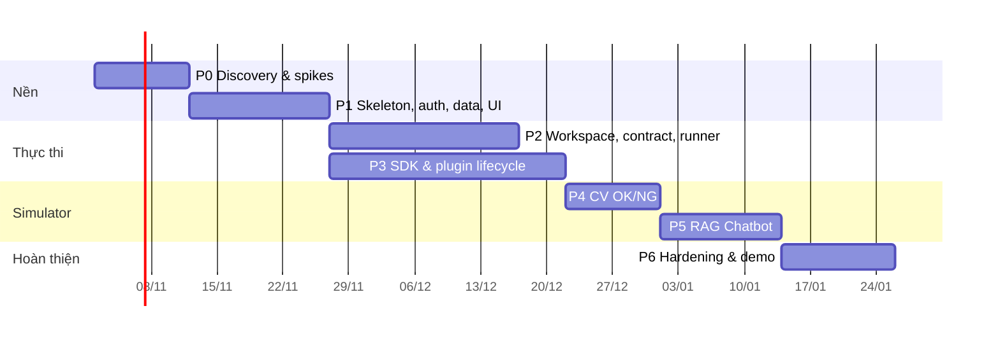

# 12 — Kế hoạch phát triển theo phase

## Giả định ước lượng **[GIẢ ĐỊNH]**
- Team: 1 tech lead (TL), 2 backend (BE), 1 frontend (FE), 0.5 DevOps/Security (OPS), 0.5 designer (DS) ≈ 5 người danh nghĩa.
- 1 người-ngày (pd) = 1 ngày làm việc tập trung. Đã gồm unit test và review; chưa gồm họp/overhead (~25%).
- Khoảng ước lượng thể hiện độ bất định; chốt lại sau Phase 0.

## Điều chỉnh thứ tự so với brief

| Brief | Đề xuất | Lý do kỹ thuật |
|---|---|---|
| Phase 3 SDK sau Phase 2 | **Contract schemas soạn từ Phase 1**; SDK/runner lifecycle ở Phase 3 song song cuối Phase 2 | Submission contract (Phase 2) phụ thuộc định nghĩa artifact kind của plugin |
| Phase 4 RAG → Phase 5 CV | **Phase 4 CV OK/NG → Phase 5 RAG** | CV chế độ `onnx_only` không chạy code học viên, không cần mạng/LLM → kiểm chứng plugin lifecycle với rủi ro thấp nhất. RAG cần thêm subject service, LLM gateway, egress — làm khi nền đã vững. Nếu demo stakeholder bắt buộc RAG trước, có thể đảo lại với chi phí rủi ro cao hơn |

*(Lịch minh họa ngày làm việc; ngày bắt đầu là giả định.)*

---

## Phase 0 — Discovery & quyết định kiến trúc
**Mục tiêu:** chốt giả định, stack, hạ tầng; loại bỏ rủi ro lớn nhất bằng spike.

| Công việc | Người |
|---|---|
| Phỏng vấn PO/giảng viên: trả lời Q-01…Q-06 | TL |
| Spike IDE: Monaco+xterm.js vs OpenVSCode Server trong container gVisor — đo RAM/phiên, thời gian khởi động, độ trễ terminal | FE + OPS |
| Spike sandbox: Docker + gVisor trên VM cloud được chọn; chạy onnxruntime và sentence-transformers CPU, đo overhead | OPS + BE |
| Spike importer: parse 3 file Excel thành cây với mapping profile | BE |
| Soạn đề bài CV và RAG cụ thể với giảng viên (dữ liệu, số test, ghi chú nghiệp vụ) | TL + giảng viên |
| Moodboard + token sơ bộ theo [10 §1](10-ui-navigation-screens.md); kiểm tra font tiếng Việt | DS |
| Viết ADR 0001–0008 | TL |

- **Deliverables:** ADR đã ký; báo cáo spike có số đo; đề bài 2 bài AI; moodboard; backlog Phase 1–2.
- **Dependency:** quyền truy cập cloud; giảng viên tham gia.
- **Acceptance:** mọi mục "chặn" trong [15](15-architecture-decisions.md) có quyết định; spike gVisor chạy được onnxruntime với overhead đo được.
- **Kiểm thử bắt buộc:** spike sandbox chạy thử 3 bài escape cơ bản (đọc `/proc` host, truy cập metadata IP, fork bomb) và bị chặn.
- **Rủi ro:** cloud không hỗ trợ gVisor/nested virt → dự phòng: VM bare-metal nhỏ hoặc sandbox SaaS.
- **Effort:** **10–14 pd**.
- **Điều kiện chuyển phase:** ADR được duyệt; stack và hạ tầng có quyền truy cập.

## Phase 1 — Skeleton, UI nền, auth, data model tối thiểu
**Mục tiêu:** khung chạy end-to-end (đăng nhập → xem khóa học AI/DE/BA từ Excel).

| Công việc | Người |
|---|---|
| Monorepo theo [07](07-repository-structure.md), CI lint/test, docker-compose dev | TL + OPS |
| Backend kernel: config, DB, Alembic, logging, audit, RBAC, error model | BE |
| Module identity, organizations, catalog (Course/Module/Lesson) | BE |
| Module syllabus_import: wizard API, mapping profile, row classifier, draft → publish | BE |
| `sdk/contracts` bản nháp: submission/v1, simulator.v1 (run-spec, result, events, plugin manifest) + codegen | TL |
| FE: design system (tokens, typography, Button, Table, StatusBlock, Tabs), shell, routing theo vai trò, login | FE + DS |
| FE: Tổng quan, danh sách khóa học 3 track, chi tiết khóa học/module, wizard import | FE |
| Copy deck `docs/copy/vi.yaml` + lint icon whitelist | DS + FE |

- **Deliverables:** app chạy local; 3 khóa học import từ AI/DE/BA.xlsx; DE/BA hiển thị StatusBlock.
- **Dependency:** Phase 0.
- **Acceptance:** Teacher import cả 3 file, sửa phân loại hàng, xuất bản; Student chỉ thấy course được ghi danh; không có nút hành động trên DE/BA.
- **Kiểm thử bắt buộc:** unit importer với 3 file thật (golden tree); test RBAC (student không gọi được API teacher); e2e đăng nhập + xem khóa học; visual regression design system.
- **Rủi ro:** Excel tương lai khác bố cục → mapping profile cấu hình được, không hardcode.
- **Effort:** **28–38 pd**.
- **Chuyển phase:** CI xanh; demo nội bộ luồng import.

## Phase 2 — Workspace/IDE, template, submission contract, runtime tối thiểu
**Mục tiêu:** học viên mở workspace, code, chạy, khai báo artifact và nộp.

| Công việc | Người |
|---|---|
| Sandbox host: Docker + gVisor, firewall, egress-proxy, PyPI proxy | OPS |
| runner-agent: mTLS, tạo/hủy container theo spec ký, quota, log stream, reaper | BE |
| workspace-agent: FS API, PTY, process, ripgrep | BE |
| Image `workspace-python-cpu` | OPS |
| Backend: workspaces module (lifecycle, WS proxy), assignments (template, contract), submissions (manifest, snapshot, validation tầng lõi) | BE |
| FE: Workspace (file tree, tabs, Monaco, terminal, run, problems), panel "Sản phẩm nộp", lịch sử nộp | FE |
| Assignment package import CLI (`tools/package-cli`) cho seed | BE |

- **Deliverables:** workspace chạy trên sandbox host; nộp được submission có manifest hợp lệ.
- **Dependency:** Phase 1; hạ tầng sandbox.
- **Acceptance:** mở workspace ≤ 15s (cold) **[GIẢ ĐỊNH mục tiêu]**; terminal tương tác; đổi tên file model → panel báo `PATH_NOT_FOUND` và chọn lại được; snapshot bất biến có sha256.
- **Kiểm thử bắt buộc:** escape suite ([14](14-test-plan-acceptance.md) §3); quota (fork bomb, OOM, disk đầy, log flood); WebSocket reconnect; test manifest validation (mọi mã lỗi).
- **Rủi ro:** độ trễ terminal qua proxy; I/O gVisor chậm khi `pip install` → cache wheel, đo sớm.
- **Effort:** **40–55 pd**.
- **Chuyển phase:** escape suite pass; demo nộp bài.

## Phase 3 — Simulator SDK & plugin lifecycle
**Mục tiêu:** chạy được một plugin bất kỳ theo contract, có state machine đầy đủ.

| Công việc | Người |
|---|---|
| Hoàn thiện `simulator.v1` schemas; `cole_sim_sdk` (contexts, event writer, main) | TL + BE |
| Orchestrator: state machine Run, timeout 3 tầng, cancel, retry provisioning, cleanup, SSE | BE |
| Subject launcher: `python_entrypoint` harness server, `http_service` healthcheck | BE |
| Plugin registry: đăng ký version (chạy `describe`), enable/disable, pin khi publish | BE |
| Testkit + contract tests dùng chung; plugin `echo-sample` | BE |
| FE: renderer registry, `generic-table@1`, trang Run (tiến độ, log, kết quả), Admin plugin | FE |
| FE: Assignment builder bước 06–08, cấu hình simulator (form từ JSON Schema) | FE |

- **Deliverables:** `echo-sample` chạy end-to-end; Admin bật/tắt plugin.
- **Dependency:** Phase 2 (runner, submission).
- **Acceptance:** mọi trạng thái kết thúc trong [06 §5](06-simulator-plugin-architecture.md) tái hiện được bằng fixture; cancel giữa chừng dọn sạch container; PR thêm `echo-sample` không đụng `backend/`.
- **Kiểm thử bắt buộc:** contract tests; chaos test (kill worker giữa run → reaper dọn, run → ERROR); compat matrix ban đầu.
- **Rủi ro:** contract thay đổi nhiều khi làm plugin thật → chấp nhận `v1` còn ở trạng thái `beta` đến hết Phase 5.
- **Effort:** **18–25 pd**.
- **Chuyển phase:** echo-sample + contract tests xanh trong CI.

## Phase 4 — CV OK/NG end-to-end
| Công việc | Người |
|---|---|
| Plugin `cv-ok-ng`: validate ONNX, preprocessing, inference, metric, latency, business cost | BE |
| Chế độ `python_impl` qua harness | BE |
| Assignment package `ai-cv-ok-ng-inspection` (template, dataset, test set có nhãn, docs export ONNX) | TL + giảng viên |
| FE renderer `cv-grid@1`; builder test set ảnh | FE |

- **Acceptance:** submission mẫu đúng cho metric khớp tính tay trên fixture; submission sai cho đúng mã lỗi; nhãn chuẩn không xuất hiện trong workspace/subject (kiểm tra tự động).
- **Kiểm thử:** golden result; ONNX độc (custom op, external data traversal); test hiệu năng 400 ảnh trong giới hạn thời gian.
- **Rủi ro:** học viên export ONNX lệch preprocessing → tài liệu + lỗi `ONNX_INPUT_SHAPE` rõ ràng.
- **Effort:** **20–28 pd**.
- **Chuyển phase:** demo CV với giảng viên.

## Phase 5 — RAG Chatbot end-to-end
| Công việc | Người |
|---|---|
| LLM gateway: triển khai, virtual key theo workspace/run, ngân sách, đồng bộ usage | OPS + BE |
| Subject `http_service` cho RAG: build image theo requirements (cache), network chỉ tới gateway | BE + OPS |
| Plugin `rag-chatbot`: gửi câu hỏi text/ảnh, xử lý lỗi, đo latency, usage | BE |
| Evaluation module: đánh giá sao, nhận xét, append-only; tổng hợp | BE |
| Assignment package `ai-rag-enterprise-chatbot` (tài liệu doanh nghiệp mẫu, câu hỏi, ghi chú critical, template FastAPI) | TL + giảng viên |
| FE renderer `rag-chat@1`, RatingControl, khối cảnh báo đỏ | FE |
| (Nếu Q-04 = có) chế độ external_endpoint qua egress-proxy chống SSRF | BE + OPS |

- **Acceptance:** câu hỏi có ảnh tới đúng ứng dụng dạng base64 theo contract; đủ 8 tình huống lỗi ở [09 §A.6](09-poc-simulators.md); đánh giá sao lưu và xem lại được; vượt ngân sách bị chặn đúng.
- **Kiểm thử:** mock RAG app cho từng tình huống lỗi; test secret (grep key provider trong workspace/subject/log = 0 kết quả); SSRF suite nếu bật external.
- **Rủi ro:** chi phí LLM; độ trễ embedding CPU → model embedding nhỏ, index dựng sẵn khi build subject.
- **Effort:** **25–35 pd**.

## Phase 6 — Hardening, kiểm thử, demo, đánh giá POC
| Công việc | Người |
|---|---|
| Chạy toàn bộ checklist [14](14-test-plan-acceptance.md); sửa lỗi | Cả team |
| Load test: N học viên đồng thời mở workspace + run | OPS |
| Dashboard quan sát; runbook vận hành | OPS |
| Đo chi phí thực/run, cập nhật [13](13-cost-risk.md) | TL |
| Pilot với 5–10 học viên thật, thu phản hồi | TL + giảng viên |
| Báo cáo đánh giá POC: tiêu chí đạt/chưa đạt, khuyến nghị giai đoạn sau | TL |

- **Acceptance:** toàn bộ tiêu chí nghiệm thu [14 §1](14-test-plan-acceptance.md) đạt hoặc có ngoại lệ được PO chấp thuận.
- **Effort:** **24–35 pd**.

## Tổng hợp effort

| Phase | pd (min–max) |
|---|---|
| P0 | 10–14 |
| P1 | 28–38 |
| P2 | 40–55 |
| P3 | 18–25 |
| P4 | 20–28 |
| P5 | 25–35 |
| P6 | 24–35 |
| **Tổng** | **165–230 pd** |

Với ~5 người và overhead ~25%: **khoảng 11–14 tuần lịch**. Đường găng: hạ tầng sandbox (P0–P2) → orchestrator (P3) → LLM gateway (P5).
